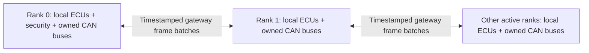

[](LICENSE)

# IVNS: parallel ECU and CAN simulation

The In-Vehicle Network Simulator (IVNS) models automotive network timing and
security protocols, including LWA/LASAN, TESLA, and TLS. This branch adds a
parameterized headless LWA scenario that runs **ECU protocol processing and CAN
bus events concurrently across MPI ranks**, using mpi4py and local SerializableSimpy
CAN kernels.

The default parallel entry point is [`main_lwa_param.py`](main_lwa_param.py).
The original fixed preset and the earlier CAN-only RPC backend remain available
for comparison; they use different execution arrangements described below.

## Quick start

Use Python 3.11 and an installed MPI runtime compatible with mpi4py. The parallel
implementation has been exercised on Linux with Open MPI 5.0.7.

```sh
python3.11 -m venv .venv
source .venv/bin/activate
python -m pip install -r requirements-mpi.txt
mpiexec -n 4 python main_lwa_param.py --ecus 24 --buses 4 --duration 200
```

`--ecus` counts regular secure ECUs. The scenario adds one security module and
one gateway between each adjacent pair of buses. ECUs are spread round-robin
across a chain of buses; each ECU sends to the next ECU in a ring. Every regular
ECU authenticates through the LWA protocol.

The default run uses 6 ECUs, 3 buses, and 200 simulated seconds. Change send
interval, start time, gateway delay, seed, and output directory at launch:

```sh
python main_lwa_param.py --help
mpiexec -n 4 python main_lwa_param.py --ecus 12 --buses 4 --interval 0.25 --output-dir TestSimulation/logs/example
```

Require `2 <= ecus <= 1792` and `1 <= buses <= ecus`. The identifier bound is
not a validated model-capacity claim. See the [parameter and architecture guide](docs/lwa-param.md)
for defaults, constraints, and authentication warmup considerations.

## What runs in parallel

Each active rank owns one or more buses **and the ECU processes attached to them**.
Rank 0 also computes and owns the security module on `CAN_0`. The number of
active ranks is `min(MPI ranks, buses)`; excess ranks do not join simulation exchanges.



- ECU application, authentication, authorization, and communication-layer
  generators execute locally on their owner rank. They are not sent through MPI.
- Each owned `MPICANBus` calls a local `CANService` and SerializableSimpy kernel
  for arbitration and transmission timing. There are no per-frame CAN RPC round trips.
- Gateway filters select forwarding directions. Detached frame/payload snapshots
  cross ranks with absolute arrival times and enter the target gateway port's
  data-link transmit buffer, where they still contend for the destination bus.
- Ranks process safe time windows concurrently, then exchange gateway batches.
  Positive gateway delay supplies lookahead; the default window is half that
  delay, and `--sync-window` must be positive and no greater than the delay.
  Arrival times are preserved rather than rounded to window boundaries.

Configuration and PKI setup are currently replicated on active ranks, but only
owned ECU/bus processes are activated. Rank-local CSVs and logs are written under
`TestSimulation/logs/param/rank-0000`, etc.; rank 0 merges CSVs and writes
`summary.json` at the output root. Use separate output directories for concurrent jobs.

See [ECU/CAN implementation and mode comparison](docs/canbus-mpi.md) and the
[detailed ownership, synchronization, and output guide](docs/lwa-param.md).

## Choose an execution mode

| Entry point | ECU and CAN execution | Purpose |
| --- | --- | --- |
| `main_lwa_param.py` (default `--execution partitioned`) | Owned ECU processes and local CAN kernels on every active rank | Concurrent parameterized LWA simulation; supports a one-rank baseline |
| `main_lwa_param.py --execution rpc` | All ECU processes on rank 0; blocking CAN requests to other ranks | Legacy CAN-only migration/comparison mode; needs at least two ranks |
| `run_mpi_headless.py` | Fixed original LWA preset using CAN-only RPC | Earlier fixed-topology MPI scenario; needs at least two ranks |
| `run_headless.py` | Original fixed preset in a single SimPy process | Historical serial scenario; needs only `requirements.txt` |

A one-rank run of the **same generated workload** is the appropriate baseline
for partitioned speedup measurements:

```sh
mpiexec -n 1 python main_lwa_param.py --ecus 24 --buses 4 --duration 200 --output-dir TestSimulation/logs/one-rank
```

The fixed preset has different topology/traffic details and is not an equivalent
baseline for that command. To run it independently:

```sh
python -m pip install -r requirements.txt
python run_headless.py
```

## Scaling and current limits

Measured full-launcher speedups on four ranks included **1.84x** for a 12-ECU,
four-bus workload and **2.22x** with denser application traffic, relative to
each workload's own one-rank run. These are medians of three launches on a shared
cloud host, not guaranteed gains. See [measurements, raw samples, and caveats](docs/partitioned-scaling.md).

More ranks help only while there are enough buses, CPU capacity, and balanced
work. More ECUs add useful work but also authentication, congestion, and traffic.
More buses create partitions but add gateways and forwarding hops. Shorter
gateway delays/windows require more synchronization; a single bus cannot gain
partition concurrency from extra ranks. Longer runs can amortize startup, while
larger exports increase serial output costs.

Replicated configuration setup, the central security module, collective waiting,
and final merging/digest generation limit scaling. ECU generators remain
nonserializable, so whole-simulation checkpoint/restart is unavailable; the CAN
kernel can be serialized independently. Zero-delay gateways require RPC mode.
Partitioned validation targets the generated static LWA scenario on single-node
Linux; Windows MPI and multi-node behavior/performance remain unverified. Existing
`p_sec_mod_cert_size` configuration messages remain in the legacy model.

## Verification and documentation

```sh
python -m unittest discover -s tests -v
python tests/param_lwa_smoke.py
python tests/partitioned_mpi_smoke.py
python benchmarks/benchmark_lwa.py --suite factors --repeats 3 --output work/scaling.json
```

The MPI tests check real ECU authentication and application reception, and compare
semantic event traces across rank counts, safe windows, and a monolithic reference
using the same snapshot communication model. They do not establish full-state
equivalence to legacy shared-object gateways. Benchmark sampling and limitations
are documented alongside the measurements.

- [ECU/CAN architecture and execution-mode comparison](docs/canbus-mpi.md)
- [Launch parameters, synchronization, results, and scaling factors](docs/lwa-param.md)
- [Measured scaling and reproducible benchmarks](docs/partitioned-scaling.md)
- [Historical serial baseline evidence](docs/baseline-evidence.md)

## Repository and model background

| Path | Contents |
| --- | --- |
| `ECUSimulation/` | ECU layers, security protocols, CAN buses, gateways, configuration, and simulation API |
| `ECUInteraction/` | Original GUI and visualization plugins |
| `TestSimulation/` | Original scenario examples and generated logs |
| `main_lwa_param.py` | Parameterized ECU/CAN parallel launcher |
| `tests/`, `benchmarks/`, `docs/` | Correctness checks, performance driver, and documentation |

IVNS uses measured cryptographic latencies from
`ECUSimulation/config/data/measurements.db`, together with configuration in
`project.ini`, `timings.ini`, and `can_ids.ini`. ECU layers and protocol models
can be extended through the simulation API. The original project targeted Python
2.7 and a PyQt4 GUI; this branch's headless execution uses Python 3.11 and a
synchronous signal adapter. The original GUI has not been revalidated.

## Attribution and support

Original IVNS design and implementation: **Artur Mrowca**. Upstream source:
[PhilippMundhenk/IVNS](https://github.com/PhilippMundhenk/IVNS). Original history
and [MIT license](LICENSE) are preserved.

The original work was created at TUM CREATE with financial support from the
Singapore National Research Foundation through its Campus for Research
Excellence and Technological Enterprise (CREATE) programme.

Original tutorials: [IVNS wiki](https://github.com/arturmrowca/IVNS/wiki).
