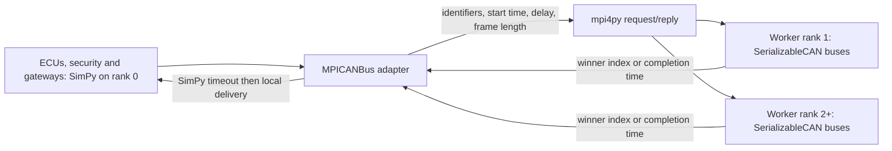

# SerializableSimpy and MPI CAN backend

Based on `environment-setup` at `73e6b4682c295a83e5c113a06d9bbe9e0d5d1e5d`.
This branch implements an opt-in CAN migration backend. The ECU/security
workload still runs in one process; this implementation does not claim parallel
speedup or a fully distributed IVNS simulation.

For launch-time ECU and CAN bus counts, use
[`main_lwa_param.py`](../main_lwa_param.py), for example
`mpiexec -n 4 python main_lwa_param.py --ecus 12 --buses 3`.
See [parameterized topology and scaling limitations](lwa-param.md).

## Architecture



Previously, `AutomotiveEnvironment` ran every ECU and `StdCANBus` generator in
one SimPy environment. Bus arbitration selected the lowest CAN identifier,
then a generator waited for the configured transmission delay and called local
transceivers. These Python generators, SimPy stores, and shared ECU references
cannot simply be serialized into another process.

The new `MPICANBus` inherits the existing gathering, arbitration-delay,
monitoring, delivery filtering, gateway-loop suppression, and synchronization
interfaces. It sends ordered CAN identifiers to its worker and maps the returned
winner index back to the original message. Equal identifiers retain the legacy
first-candidate ordering. It also sends each transmission's timing metadata to
a callback-based `SerializableCAN` state machine. The worker returns the actual
completion timestamp; the adapter checks it, yields the original SimPy delay,
delivers to local receivers, and releases `sync_send` as before.

The legacy delay calculation/cache is extracted into `_transmission_delay()`
and used by both adapters, including the existing minimum 1 microsecond delay
for nonpositive totals. This deliberately retains the legacy use of the global
bus data rate and cache-by-frame-length behavior.

Each bus has persistent worker affinity, assigned round-robin in order of first
use. The three preset buses can therefore occupy three workers with four MPI
ranks. Unused workers still receive shutdown messages. Only rank 0 constructs
the topology and writes monitoring files. Payloads, encryption objects,
SimPy stores, and ECU objects never cross MPI.

`SerializableCAN` owns its own SerializableSimpy environment, a pending
transmission, last completion timestamp, and transmission count. Its pending
callback can be pickled and resumed independently. This is **bus-kernel
checkpointing**, not whole-IVNS checkpointing or automatic worker restart.
MPI communicators are kept outside that state.

## Causality and performance

The coordinator uses blocking requests. Before scheduling a local delivery, it
obtains the worker result. Other rank-0 events still execute in their original
SimPy order during the simulated transmission delay. Workers can be ahead in
their isolated bus clocks, but cannot trigger local ECU effects themselves.
There is no fixed synchronization delta, speculative delivery, or rollback.

This uses `SerializableSimpy.core.Environment` with a custom mpi4py service,
not `MPIGlobalEnv`. The library's delta-based MPI environment is not a safe
drop-in replacement for IVNS's generator-driven environment and zero-delay
interactions. SerializableSimpy 0.0.3 also leaves callbacks exactly at `until`
pending; the kernel advances to the next representable float and records the
callback's actual timestamp to handle this boundary explicitly.

Requests are serialized across all workers: there is **no concurrent bus
computation in this version**. CAN arbitration and timing calculation are cheap,
so MPI overhead is expected to dominate. One observed seeded run took about
2.02 seconds in serial and 2.84 seconds with four ranks, measured by the preset's
internal timer. These are single observations, not a benchmark or a speedup.

To obtain useful within-scenario parallelism, a subsequent migration must move
ECU protocol state and generators into callback processes alongside their bus,
replace gateway object calls with timestamped messages, and implement a
conservative synchronization protocol with proven lookahead (including
zero-delay paths). Another usable parallel unit is an independent complete
scenario or Monte Carlo run. Neither change is included here.

## Run

Use the baseline's Python 3.11 environment and an MPI implementation compatible
with mpi4py (for example Open MPI on Linux or MS-MPI on Windows).

```sh
python -m pip install -r requirements-mpi.txt
mpiexec -n 4 python run_mpi_headless.py
```

Two ranks are sufficient; additional ranks provide additional worker owners.
The runner executes the existing 200-second, three-bus LWA preset. Output paths
remain `TestSimulation/logs`. Run serial and MPI scenarios sequentially to
avoid overwriting each other's output. The normal entry point remains:

```sh
python run_headless.py
```

For another scenario, install `MPICANRuntime` on rank 0, run `serve` on the other
ranks as in `run_mpi_headless.py`, and select `MPICANBus` through `api.set_busses`.
The preset's `IVNS_CAN_BACKEND=mpi` selection is configured by the MPI runner;
setting this flag alone does not start workers. Do not substitute `MPICANBus`
for `RapidCANBus`, which has a different data-link interface.

The standard installation does not need SerializableSimpy or mpi4py; optional
modules are imported lazily outside the bus factory's scanned module directory.
Worker operation errors are returned to the host and retained so the launcher
exits unsuccessfully even if a legacy IVNS exception handler catches the error.
Normal completion and host exceptions trigger worker shutdown. Process loss or
an MPI transport hang still requires the MPI launcher's job management; this
backend does not implement fault tolerance or a transport timeout.

## Verification

Executed on Linux, CPython 3.11.18, Open MPI 5.0.7, serializable-simpy 0.0.3,
mpi4py 4.1.1, and the baseline's pinned four dependencies:

```sh
python -m unittest discover -s tests -v
mpiexec -n 2 python tests/mpi_can_smoke.py
mpiexec -n 4 python tests/mpi_can_smoke.py
python tests/run_seeded_lwa.py serial
# Preserve the CSVs elsewhere before running the next command.
mpiexec -n 4 python tests/run_seeded_lwa.py mpi
python tests/compare_lwa_outputs.py /path/to/preserved/serial/logs TestSimulation/logs
```

Five unit/integration tests passed, including a checkpoint with a pending
callback, invalid/overlapping times, independent bus clocks, stable arbitration
ties, and serial/adapter parity. The parity fixture covers simultaneous
contenders, normal and nonpositive configured transmission delays, selective
receivers, sender exclusion, gateway-loop exclusion, and send-completion tokens.
Real two-rank and four-rank smoke tests passed serial/adapter parity, worker
affinity, error propagation, recovery after a rejected operation, and shutdown.

Both full seeded presets completed through 200 simulated seconds with final
monitor sample 199.5. After normalizing Python object memory addresses, all
nonempty output records matched in order and content:

| File | Serial records | Four-rank MPI records |
| --- | ---: | ---: |
| buffer.csv | 5,824 | 5,824 |
| can_bus.csv | 17,948 | 17,948 |
| checkpoints.csv | 6,106 | 6,106 |

Counts include headers where present. Both runs emitted the same 12 pre-existing
`Unable to set setting: p_sec_mod_cert_size` messages and no traceback. The seeded
runner replaces UUID generation only in the test process to permit comparison;
do not use its predictable identifiers as security material. Unseeded serial
and MPI runs also completed with active output. No GUI, Windows MPI run,
multi-node execution, process-failure recovery, or historical numerical
equivalence was validated.
