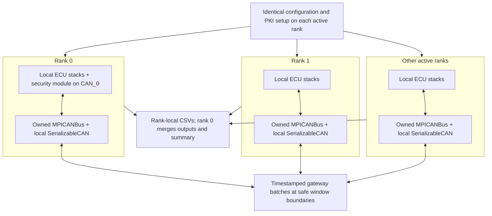

# Concurrent LWA bus/ECU partitions

`main_lwa_param.py` now defaults to **partitioned execution**: ECU/security and
CAN events run concurrently on multiple MPI ranks. SerializableSimpy CAN operations
are local calls, replacing blocking per-frame MPI requests. The previous backend
remains available as `--execution rpc`; the [implementation overview and mode
comparison](canbus-mpi.md) explains both architectures.

## Launch

For Windows, use 64-bit Python 3.11 and MS-MPI. See the
[Windows setup and preflight guide](windows-benchmarking.md). In PowerShell:

```powershell
.\.venv\Scripts\python.exe -m pip install -r requirements-mpi.txt
mpiexec -n 4 .\.venv\Scripts\python.exe main_lwa_param.py --ecus 24 --buses 4 --duration 200
```

All four ranks compute; rank 0 is no longer a dedicated coordinator. For a serial
strong-scaling baseline, run the same workload with `mpiexec -n 1`. For the old
arrangement, add `--execution rpc` (which needs at least two ranks).

## Architecture



Each bus and its attached regular ECUs have one owner. Bus ownership is
`bus_index % active_ranks`, where `active_ranks = min(bus_count, rank_count)`.
One rank can own several buses. Excess ranks do not join simulation collectives,
although they still incur MPI job startup/finalization costs.

Existing SimPy generators stay within their owning process. Moving their execution
does not require serializing those generators: only detached CAN frame snapshots
cross rank boundaries. `MPICANBus` calls its local `CANService`/SerializableSimpy
callback kernel for arbitration and transmission timing. Existing delay-cache,
controller, buffer, and send-completion interfaces remain.

Each rank currently constructs a full configuration replica to initialize legacy
certificates, public-key registries, filters, and security registration consistently.
It then activates **only** owned ECU and bus processes. Nonlocal replicas do not
process protocol events. Gateway port processes initialized during setup remain
idle unless their bus is local. This costs duplicated setup time and memory.

Initial PKI and gateway identities use the same deterministic setup sequence.
Normal UUID generation is restored after construction. Each application's interval
jitter has an ECU-specific RNG, so rank placement does not change the workload.
Opaque UUID/nonce values are excluded from the semantic trace digest.

## Gateway transport and causality

The original gateway filters decide which forwarding directions accept a frame.
Forwarding snapshots the frame and payload, excluding its SimPy environment.
The envelope contains source/target bus, gateway identity, sequence, and
`arrival = source_receive_time + gateway_delay`. At that timestamp, the owner
inserts the snapshot into the target gateway port's existing data-link transmit
buffer. It still contends for the CAN bus; it is not delivered directly to an app.

Positive gateway delay supplies conservative lookahead. Ranks independently
process half-open windows `[t, t + window)`, then exchange queued frames with one
batched MPI `alltoall`. Since `window <= gateway_delay`, effects generated during
the window cannot reach a neighbor before its end. Absolute delivery timestamps
are preserved; delivery is not rounded to a synchronization boundary.

The default window is half the gateway delay. `--sync-window` must be positive
and at most the delay. Actual forwarding delays are checked, and late/misrouted
frames are rejected. Zero-delay gateways require the old RPC mode. Increasing a
modeled delay simply for speed changes the simulation being studied.

Even colocated gateway edges use snapshots and the same batch path. Incoming
frames are sorted by arrival time, source bus, target bus, and per-edge sequence.
Gateway arrivals precede rank-local events at equal timestamps. This defines
boundary ordering and prevents subsequent mutations from changing an in-flight
frame. These are semantics of the new snapshot model: bit-for-bit equivalence to
the legacy shared-object gateway is not claimed for exact ties or mutable aliasing.

## Inputs and results

| Option | Default | Meaning |
| --- | ---: | --- |
| `--ecus` | 6 | Regular secure ECUs, excluding security module and gateways |
| `--buses` | 3 | CAN buses |
| `--execution` | `partitioned` | Concurrent partitions, or legacy `rpc` |
| `--duration` | 200 | Simulated seconds |
| `--start` | 10 | First application send attempt |
| `--interval` | 0.5 | Send interval per ECU, in simulated seconds |
| `--gateway-delay` | 2 | Forwarding delay per gateway, in simulated seconds |
| `--sync-window` | delay / 2 | Conservative synchronization interval |
| `--seed` | 1729 | Initialization/application-jitter seed |
| `--output-dir` | `TestSimulation/logs/param` | Result directory; reruns overwrite results |

ECUs are assigned round-robin to buses. Buses form a chain, with one gateway per
adjacent pair and one security module on `CAN_0`. Every ECU authenticates and sends
a 50-byte payload to the next ECU in a ring; the last sends to `ECU_0`. Streams
use unique CAN IDs starting at `0x100`. Constraints remain `2 <= ECUs <= 1792` and
`1 <= buses <= ECUs`; the identifier bound is not a validated capacity claim.
Increase duration/start when authentication needs more simulated time.

Partitioned runs write CSVs/logs under `rank-0000`, `rank-0001`, etc. Rank 0 merges
closed CSV files at the output root and writes `summary.json`. Use different
directories for concurrent jobs. RPC mode retains the previous output layout.
The summary records actual rank/ECU/bus ownership, scheduled transmissions, gateway frames
and bytes, window count, per-rank compute and exchange/wait times, final simulated
time, wall time, and semantic digest. Exchange time includes load-imbalance waiting.
Summary wall time excludes MPI startup/finalization; benchmarks also time the launcher.

The digest retains checkpoint times, component IDs, tags, sizes, stream and CAN IDs;
it ignores addresses and opaque identifiers. It is a reproducibility check, not
proof of full-state or historical numerical equivalence. Sampled CSVs need not
include all events through the exact final simulation time.

## How input factors affect speedup

A useful model is:

`T(P) = setup(P) + sum_over_windows(max_rank(local_work)) + exchange(P) + merge`.

| Factor | Effect |
| --- | --- |
| More ranks, fixed workload | Reduces local work until bus count, CPU capacity, load imbalance or communication dominates. Beyond bus count, ranks are idle. |
| More ECUs, fixed buses | Adds authentication, receive and send work to existing partitions. More work can amortize exchange, but cannot create concurrency beyond bus count. The central security module, buffers and congestion can dominate. |
| More buses, fixed ECUs | Creates partitions and reduces some contention, but adds gateways and chain hops. The ring's final-to-first stream crosses the whole chain. Runtime need not decrease monotonically. |
| Shorter send interval | More compute and gateway traffic can amortize synchronization or saturate buses/buffers and communication. Dropped traffic can distort throughput comparisons. |
| Smaller gateway delay/window | Less lookahead; approximately `duration/window` exchanges. Tiny windows can erase speedup. Reducing the window preserves timestamps; changing gateway delay changes the model. |
| Longer duration | Amortizes setup/startup, but adds work and exchanges. Larger exports increase serial merging/digest cost. |

The useful parallelism is bounded by buses, active ranks, and CPU capacity.
Balanced ECU counts do not imply balanced work: `CAN_0` hosts centralized security
and gateway traffic is uneven. Every window waits for the slowest rank. Full
configuration replicas add startup/memory cost; merging and hashing remain serial.
With 20% effectively serial work, Amdahl's ideal four-way bound is only 2.5x.

Hold all model inputs constant when scaling ranks. Changing ECUs, topology,
interval or delay changes the workload; compare each such case to its own one-rank
baseline. The old asymmetric fixed preset is not that baseline. See
[measured scaling results](partitioned-scaling.md) and the reproducible driver:

```sh
python benchmarks/benchmark_lwa.py --suite factors --repeats 3 --output work/scaling.json
```

## Validation and limits

```sh
python -m unittest discover -s tests -v
python tests/param_lwa_smoke.py
python tests/partitioned_mpi_smoke.py
```

Tests cover pending CAN checkpoints, arbitration, snapshot isolation, late/misrouted
frames, exact-boundary delivery/order, parameter constraints, and launcher errors.
Real MPI topology tests cover single buses, uneven populations, multiple buses
per rank, and surplus ranks. Every ECU must authenticate and receive data.

The distributed trace test compares seven executions of a seven-ECU, three-bus,
60-second workload: an immediate-message one-rank reference without window buffering;
1/2/3/4-rank runs with a one-second window; and two additional two-rank runs with
windows of 0.5 and 2 seconds. All match
the semantic event digest exactly. The reference uses the new snapshot model,
rather than the old shared-object gateway model.

ECU generators are still nonserializable, so whole-partition checkpoint/restart
is not implemented. Bus kernels remain independently serializable. A rank
exception aborts the MPI job to avoid leaving peers blocked in a collective;
rank-loss recovery is not implemented. This targets the generated static LWA
topology, not arbitrary dynamic IVNS models. Collective batch metadata grows
with rank count; neighbor-only exchange and partition-aware setup construction
are further opportunities. Native Windows preflight is provided for the benchmark
machines; multi-node performance remains unverified. Existing `p_sec_mod_cert_size` errors
still appear in the legacy configuration logs.
